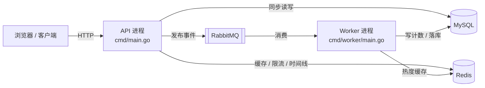
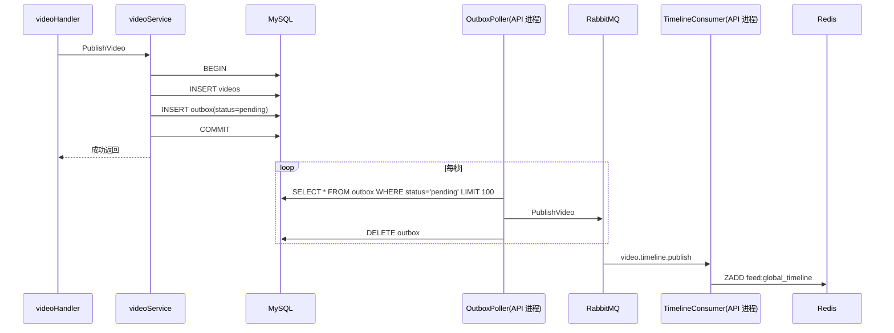
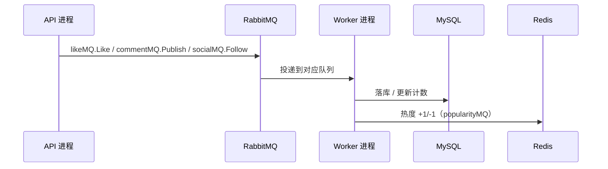

# 01 · 全局骨架与启动流程

> 对象：`backend/cmd/main.go`、`backend/cmd/worker/main.go`、`backend/internal/http/router.go`、`backend/internal/db/db.go`
> 目标：搞清楚「请求怎么进来→怎么出去」和「异步链路怎么跑起来」。
> 读完要能回答：为什么拆两个进程？RabbitMQ 没起来为什么 API 还能跑？

---

## 0. 先建立一张全图

这个后端由**两个可以独立运行的程序（进程）**组成，它们共用同一套 MySQL / Redis / RabbitMQ。



两个进程的分工：

| | API 进程 | Worker 进程 |
|---|---|---|
| 入口 | `backend/cmd/main.go` | `backend/cmd/worker/main.go` |
| 对外形态 | HTTP 服务，监听端口 | 无端口，只连 MQ |
| 主要工作 | 同步请求处理 | 后台消费消息 |
| MySQL | 硬依赖，连不上就退出 | 硬依赖，重试 10 次后退出 |
| Redis | 可选，连不上降级为 `nil` | 可选，连不上则不启动热度 worker |
| RabbitMQ | 可选，连不上降级为 `nil` | 硬依赖，重试 10 次后退出 |

记住这张表，后面的所有行为都能从这里推导出来。

---

## 1. `cmd/main.go` —— API 进程的启动器

### 1.1 它是什么

这个文件**没有任何业务逻辑**，职责只有一件：把依赖一个个准备好，交给路由模块，然后开始监听端口。

它的结构是一条固定顺序的流水线：

```
.env → 配置 → MySQL(+AutoMigrate) → Redis → RabbitMQ → pprof → SetRouter → r.Run
```

### 1.2 逐段说明

```go
// 1) 本地开发用 .env，读不到不报错
if err := godotenv.Load(); err != nil {
    log.Println(".env not found; continuing")
}

// 2) 配置优先级：环境变量 CONFIG_PATH > 默认路径 configs/config.yaml
configPath := os.Getenv("CONFIG_PATH")
if configPath == "" {
    configPath = "configs/config.yaml"
}
cfg, usedDefault, err := config.LoadLocalDev(configPath)
```

`LoadLocalDev` 返回三个值：配置对象、是否用了兜底默认配置、错误。配置文件不存在时会用内置默认值继续跑，而不是直接退出——这是本地开发友好设计。

```go
// 3) MySQL：硬依赖
sqlDB, err := db.NewDB(cfg.Database)
if err != nil {
    log.Fatalf("Failed to connect database: %v", err)   // 直接退出
}
if err := db.AutoMigrate(sqlDB); err != nil {           // 自动建表
    log.Fatalf("Failed to auto migrate database: %v", err)
}
```

注意这里的对比：**MySQL 连不上是 `Fatalf`（进程退出），Redis / RabbitMQ 连不上只是打日志**。这个差异是后面「MQ 挂了我还能跑吗」的答案来源。

```go
// 4) Redis：可选依赖
cache, err := rediscache.NewFromEnv(&cfg.Redis)
if err != nil {
    log.Printf("Redis config error (cache disabled): %v", err)
    cache = nil                       // 置 nil，程序继续
}
// 即使创建成功，还要 Ping 一次，300ms 超时
if err := cache.Ping(pingCtx); err != nil {
    log.Printf("Redis not available (cache disabled): %v", err)
    _ = cache.Close()
    cache = nil                       // Ping 失败同样置 nil
}
```

**变量含义**：`cache` 是 `*rediscache.Client`。它非空表示 Redis 可用；为 `nil` 表示所有缓存/限流/时间线功能关闭。

```go
// 5) RabbitMQ：可选依赖
rmq, err := rabbitmq.NewRabbitMQ(&cfg.RabbitMQ)
if err != nil {
    log.Printf("RabbitMQ config error (disabled): %v", err)
    rmq = nil                         // 置 nil，程序继续
} else {
    defer rmq.Close()
}
```

`rmq` 里只有一条 `amqp.Connection`，**不持有 Channel**——Channel 由各组件按需创建（见 `internal/middleware/rabbitmq/rabbitMQ.go`）。这是刻意的：AMQP 的 Channel 不是并发安全的，一个 Channel 被多个 goroutine 同时用会出问题。

```go
// 6) pprof：可选，失败只打日志
pprofServer, err := observability.NewPprofServer("API", enabled, addr)

// 7) 组装路由（依赖注入的总入口）
r := apphttp.SetRouter(sqlDB, cache, rmq)

// 8) 开始监听，阻塞在这一行直到进程被杀
r.Run(":" + strconv.Itoa(cfg.Server.Port))
```

### 1.3 一句话记忆

> `main.go` 是**装配工**：连三个基础组件，把结果塞进 `SetRouter`，然后 `r.Run` 挂起。

---

## 2. `cmd/worker/main.go` —— Worker 进程的启动器

### 2.1 它是什么

第二个可执行程序。它**不监听任何端口**，浏览器访问不到。它的工作是：守着 4 个队列，来一条消息就处理一条。

### 2.2 执行顺序

```
配置 → MySQL(重试10次) → Redis(可选) → RabbitMQ(重试10次)
→ 声明 4 组拓扑 → 建 4 个 Repository → 起 4 个 goroutine → 等退出信号
```

### 2.3 重试与硬依赖

```go
func connectWithRetry(name string, maxRetries int, fn func() error) {
    for i := 0; i < maxRetries; i++ {
        if err := fn(); err == nil { return }
        wait := time.Duration(1<<i) * time.Second   // 1s,2s,4s,... 指数退避
        if wait > 30*time.Second { wait = 30 * time.Second }
        time.Sleep(wait)
    }
    log.Fatalf("%s: 超过最大重试次数", name)
}
```

**为什么 worker 对 MQ 是硬依赖**：worker 的全部工作就是消费消息。没有 MQ，它启动起来也是空转，所以宁可退出让编排系统重启它。

### 2.4 声明 4 组拓扑

文件顶部 4 个常量组，对应 4 组交换机/队列：

| Exchange / Queue | Routing Key | 消息内容 |
|---|---|---|
| `social.events` | `social.*` | 关注 / 取关 |
| `like.events` | `like.*` | 点赞 / 取消点赞 |
| `comment.events` | `comment.*` | 评论发布 / 删除 |
| `video.popularity.events` | `video.popularity.*` | 热度 +1 / -1 |

`declareXxxTopology` 做三件事，且都是**幂等的**（已存在就跳过）：

```go
ch.ExchangeDeclare(name, "topic", durable=true, autoDelete=false, ...)
ch.QueueDeclare(queue, durable=true, ..., amqp.Table{"x-dead-letter-exchange": DLXExchange})
ch.QueueBind(queue, bindingKey, exchange, false, nil)
```

用**一个临时 Channel** 声明完所有拓扑后就 `topoCh.Close()`。原因是声明只需做一次，之后每个消费者用独立 Channel。

只有 `cache != nil` 时才声明热度拓扑——因为没有 Redis，热度 worker 也不会启动。

### 2.5 每个 worker 独立 Channel + 自动重连

```go
func runWorkerWithRetry(ctx context.Context, name string, conn *amqp.Connection, fn func(*amqp.Channel) error) {
    for {
        select {
        case <-ctx.Done(): return          // 收到退出信号就结束
        default:
        }
        ch, err := conn.Channel()          // 每次重连新建 Channel
        if err != nil { time.Sleep(5s); continue }
        ch.Qos(50, 0, false)               // 预取上限 50 条，防止一个 worker 吃光队列
        if err := fn(ch); err != nil { log... }
        ch.Close()
        time.Sleep(5 * time.Second)        // 断开后 5 秒重连
    }
}
```

**为什么要用独立 Channel**：Channel 是 AMQP 的连接复用单元，多个 goroutine 并发写同一个 Channel 会报错甚至错乱。每个 worker 一条 Channel，互不干扰。

### 2.6 4 个 worker 各自做什么

| Worker | 消费队列 | 处理逻辑 |
|---|---|---|
| `SocialWorker` | `social.events` | `follow` → 插入关注记录；`unfollow` → 删除关注记录；重复插入的错误码 1062 视为成功 |
| `LikeWorker` | `like.events` | 校验视频存在 → 幂等插入点赞 → `likes_count +1` → `popularity +1`；取消点赞反向操作 |
| `CommentWorker` | `comment.events` | `publish` → 写评论表 + 热度 +1；`delete` → 按 ID 删除 |
| `PopularityWorker` | `video.popularity.events` | 不落库，只更新 Redis 里的热度缓存 |

四个 worker 的 `Run` 结构完全一致：

```go
deliveries, err := ch.Consume(queue, "", autoAck=false, ...)
for {
    select {
    case <-ctx.Done(): return ctx.Err()
    case d, ok := <-deliveries:
        if !ok { return errors.New("deliveries channel closed") }  // 连接断了，交给外层重连
        w.handleDelivery(ctx, d)
    }
}
```

### 2.7 优雅退出

```go
ctx, stop := signal.NotifyContext(context.Background(), os.Interrupt, syscall.SIGTERM)
defer stop()

// 起 4 个 goroutine 消费...

<-ctx.Done()              // 阻塞等待 Ctrl+C / kill
time.Sleep(2 * time.Second)  // 给正在处理的消息留时间
```

`signal.NotifyContext` 把系统信号变成一个 `ctx.Done()` 通道。所有 worker 都在 `select` 里监听它，收到即返回；外层 `runWorkerWithRetry` 也监听它，收到就不再重连。

---

## 3. `internal/http/router.go` —— 路由注册 + 依赖装配总图

### 3.1 它是什么

API 进程的「总装配车间」。所有 URL 和函数的对应关系、每个模块依赖哪些组件，全写在这一个函数里。

```go
func SetRouter(db *gorm.DB, cache *rediscache.Client, rmq *rabbitmq.RabbitMQ) *gin.Engine
```

它其实做了**三件不同的事**，只是被放在了一起：

1. 装配每个业务模块的 `Repository → Service → Handler`
2. 注册路由和中间件
3. 启动进程内的后台任务

### 3.2 第一块：模块装配（三层结构）

每个业务模块都是同一个套路，以 account 为例：

```go
accountRepository := account.NewAccountRepository(db)       // Repository：只管读写 MySQL
accountService    := account.NewAccountService(repo, cache)  // Service：业务规则、缓存、发消息
accountHandler    := account.NewAccountHandler(service)      // Handler：解析 HTTP 参数、返回 JSON
```

三层职责：

| 层 | 职责 | 依赖 |
|---|---|---|
| Repository | SQL、事务 | `*gorm.DB` |
| Service | 业务规则、缓存策略、发 MQ | Repository + cache + MQ |
| Handler | 绑定请求参数、调用 Service、`c.JSON` | Service |

**为什么装配必须写在注册路由之前**：Gin 注册的 `accountHandler.Login` 是一个**绑定了 Service 的方法**。没有 db 就造不出 repo，造不出 repo 就造不出 service，`Login` 这个方法根本不存在。所以「造 handler」和「注册路由」天然无法分开。

全部模块一览：

| 模块 | 装配位置 | 特殊依赖 |
|---|---|---|
| account | 40-59 行 | cache（JWT/限流） |
| video | 61-85 行 | cache、popularityMQ |
| like | 87-103 行 | cache、likeMQ、popularityMQ |
| comment | 105-122 行 | cache、commentMQ、popularityMQ |
| social | 124-141 行 | cache、socialMQ |
| feed | 169-185 行 | cache、likeRepository |
| message | 186-196 行 | 无 |

### 3.3 第二块：中间件

**限流器**（文件开头定义，依赖 Redis）：

```go
loginLimiter    := ratelimit.Limit(cache, "account_login", 10, time.Minute, ratelimit.KeyByIP)
registerLimiter := ratelimit.Limit(cache, "account_register", 5, time.Hour, ratelimit.KeyByIP)

likeLimiter     := ratelimit.Limit(cache, "like_write", 30, time.Minute, ratelimit.KeyByAccount)
commentLimiter  := ratelimit.Limit(cache, "comment_write", 10, time.Minute, ratelimit.KeyByAccount)
socialLimiter   := ratelimit.Limit(cache, "social_write", 20, time.Minute, ratelimit.KeyByAccount)
```

两个维度：`KeyByIP` 用于未登录接口（登录/注册），`KeyByAccount` 用于已登录的写操作。Redis 为 `nil` 时限流自动失效。

**鉴权**（JWT）：

- `jwt.JWTAuth(accountRepository, cache)`：强制登录，失败返回 401
- `jwt.SoftJWTAuth(...)`：可选登录，未登录也能继续（用于 feed 列表，登录态下可以多返回一个 `is_liked` 字段）

路由分组模式：

```go
videoGroup := r.Group("/video")
{ /* 公开接口 */ }

protectedVideoGroup := videoGroup.Group("")
protectedVideoGroup.Use(jwt.JWTAuth(accountRepository, cache))
{ /* 需登录接口 */ }
```

公开与需登录接口共用同一前缀，靠分组继承实现。

### 3.4 第三块：进程内的后台任务

**注意：下面这几件事虽然叫「异步」，但跑在 API 进程里，不在 worker 进程。**

```go
// ① Outbox 轮询：把 outbox 表里的 pending 消息发到 MQ
worker.StartOutboxPoller(db, timelineMQ)

// ② 时间线消费者：消费 MQ，把视频 ID 写入 Redis ZSet
worker.StartConsumer(timelineMQ, "video.timeline.update.queue", cache, rmq)

// ③ SSE 通知：3 个队列各一个 goroutine，收到通知就推给浏览器
go func() {
    for _, q := range []string{"notification.like", "notification.comment", "notification.social"} {
        go func(queue string) { /* 循环重连 + NewNotificationWorker().Run(ctx) */ }(queue)
    }
}()
```

为什么 SSE 通知必须在 API 进程：SSE 是一条**常驻的 HTTP 连接**，服务端要拿着 `http.ResponseWriter` 往浏览器写。Worker 进程里没有 HTTP 连接对象，也拿不到浏览器，所以只能放在 API 进程。

### 3.5 一条完整请求的生命周期（以点赞为例）

```
POST /like/like
  → gin 路由匹配到 protectedLikeGroup
  → jwt.JWTAuth          解析 token，查账号
  → likeLimiter          Redis 计数，超限返回 429
  → likeHandler.Like     解析请求体
  → likeService.Like     业务逻辑
       ├─ 检查是否已点赞 / 操作 Redis
       ├─ likeMQ.Like()            发消息到 like.events
       └─ popularityMQ.Update(+1)  发消息到 video.popularity.events
  → c.JSON(200, resp)
```

**同步返回给用户时，MySQL 里的 `likes_count` 可能还没加**——真正的落库在 worker 进程里异步完成。这就是「点赞是最终一致」的原因。

---

## 4. `internal/db/db.go` —— 数据库连接与模型全景

### 4.1 三个函数

```go
func NewDB(dbcfg config.DatabaseConfig) (*gorm.DB, error)  // 拼 DSN，打开连接
func AutoMigrate(db *gorm.DB) error                        // 自动建表/补字段
func CloseDB(db *gorm.DB) error                            // 关闭连接池
```

DSN 里两个关键参数：

```
charset=utf8mb4&parseTime=True&loc=Local
```

- `parseTime=True`：让 `DATETIME` 自动映射成 Go 的 `time.Time`，不然会得到 `[]byte`
- `loc=Local`：时间按服务器本地时区解析

### 4.2 AutoMigrate 的清单 = 数据模型全景

```go
db.AutoMigrate(
    &account.Account{},   // 用户账号
    &video.Video{},       // 视频
    &video.Like{},        // 点赞记录
    &video.Comment{},     // 评论
    &social.Social{},     // 关注关系
    &video.OutboxMsg{},   // 本地消息表（outbox 模式）
    &video.Tag{},         // 标签
    &video.VideoTag{},    // 视频-标签关联（多对多中间表）
    &message.Message{},   // 私信
    &worker.Notification{}, // 通知
)
```

`AutoMigrate` 的行为：表不存在就建，字段新增就加，**但不会删字段、不会改类型**。开发期方便，生产环境通常改用显式 migration 工具。

`schema` 的真相就在这个参数列表里——想看系统有哪些实体，读这 10 行足够。

---

## 5. 异步链路全景（三种模式并存）

不要以为这个项目只用了「一种」异步方案，它同时存在三种。

### 模式 A：Outbox（视频发布 → 全局时间线）

解决的是**「写库」和「发消息」不能同时成功**的问题。



关键点：

- 视频和 outbox 消息**在同一个事务里写入**，要么都成功，要么都失败
- 轮询器只负责「把已提交的事实搬到 MQ」，所以不会出现「视频写成功但消息丢了」
- 投递成功后 `Delete` 那条 outbox 记录（不是改 status，是直接删）
- 失败就保留，下一秒继续重试——**至少一次投递**语义

### 模式 B：直接发布 + Worker 消费（点赞 / 评论 / 关注 / 热度）



Service 里是「发得出去就算成功」的写法：

```go
if s.likeMQ != nil {
    if err := s.likeMQ.Like(ctx, ...); err == nil { mysqlEnqueued = true }
}
if s.popularityMQ != nil {
    if err := s.popularityMQ.Update(ctx, videoID, 1); err == nil { redisEnqueued = true }
}
```

所以即使发送失败，接口也不会报错，只是异步副作用丢失。这是**可用性优先于一致性**的取舍。

### 模式 C：SSE 实时通知（API 进程内）

```
like/comment/social exchange
  → notification.like / notification.comment / notification.social 队列
  → NotificationWorker（API 进程）
  → 写 Notification 表 + SSEHub.Push(recipientID)
  → 浏览器 SSE 长连接收到事件
```

注意 `NotificationWorker` 在 `Run` 里还自己执行了一次 `AutoMigrate(&Notification{})`——和 `db.AutoMigrate` 重复，属于冗余但不影响正确性。

---

## 6. 核心问题解答

### 6.1 为什么拆成两个进程？

| 维度 | API 进程 | Worker 进程 |
|---|---|---|
| 延迟要求 | 低延迟，直接面向用户 | 允许慢，允许排队 |
| 扩容依据 | QPS、连接数 | 队列积压深度 |
| 故障影响 | 影响用户请求 | 只影响异步副作用 |

具体收益：

1. **隔离**：消费慢、消息堆积、worker panic 都不会拖慢或打断 HTTP 接口
2. **独立伸缩**：大促时扩 API 副本；积压时扩 worker 副本，按需分别扩
3. **独立发布**：改消费逻辑不用重启 API，反之亦然
4. **资源隔离**：worker 长时间占用 CPU/内存不影响接口响应

### 6.2 RabbitMQ 没起来，API 为什么还能跑？

因为整条链路上每一层都做了**可空处理**，一共四道防线：

```go
// 第一道：连接失败不退出
rmq, err := rabbitmq.NewRabbitMQ(&cfg.RabbitMQ)
if err != nil { log.Printf("disabled"); rmq = nil }
```

```go
// 第二道：每个 MQ 封装创建失败也只是置 nil（router.go）
likeMQ, err := rabbitmq.NewLikeMQ(rmq)
if err != nil { log.Printf("LikeMQ init failed (mq disabled)"); likeMQ = nil }
```

```go
// 第三道：Service 使用前判空
if s.likeMQ != nil { ... }
```

```go
// 第四道：进程内后台任务开头就检查
func StartOutboxPoller(db, tmq) {
    if db == nil || tmq == nil { log.Printf("disabled"); return }
}
func StartConsumer(tmq, ...) {
    if tmq == nil || rmq == nil || rmq.Conn == nil { return }
}
```

另外 MQ 方法自身也有 receiver 判空，比如 `PopularityMQ.Update` 里 `if p == nil || p.ch == nil`，即使传进来的是 typed-nil 也不会 panic。

**最终结果**：

- ✅ 同步功能正常：登录、发视频、查视频、评论列表（读 MySQL + Redis）
- ❌ 异步功能静默失效：点赞落库、评论落库、关注落库、热度统计、全局时间线、SSE 通知

而 **worker 进程是反过来的**：MQ 连不上会重试 10 次然后 `Fatalf` 退出。因为它没有 MQ 就没有工作可做。

### 6.3 为什么 Worker 里每个消费者要单独建 Channel？

AMQP 协议中，Connection 是 TCP 连接，Channel 是连接上的逻辑复用通道。**Channel 不是并发安全的**。4 个 goroutine 同时往一个 Channel 写会导致协议帧交错、报错甚至连接断开。所以每个 worker 一条独立 Channel，并且断线后重建。

---

## 7. 读这份代码时容易忽略的点

1. **`StartOutboxPoller` 和 `StartConsumer` 在 API 进程**，不在 worker 进程。名字叫 worker 但被 router 调用，位置容易看错。
2. **DLX 声明了但基本不会触发**。队列声明时挂了 `x-dead-letter-exchange`，但 4 个 worker 处理失败 3 次后执行的是 `Ack`（丢弃），不是 `Nack(requeue=false)`（进死信）。因此死信队列目前是「备而未用」。
3. **时间线消费者的重试语义有隐患**：Redis 写失败时 `Nack(false, true)` 立刻重新入队，没有延迟，Redis 持续不可用时会形成热循环。对比之下，4 个业务 worker 是「本地重试 3 次 + 指数退避」。
4. **QoS 预取数量不同**：worker 进程的业务消费者 `Qos(50)`，时间线消费者 `Qos(10)`。预取值决定单个消费者一次能缓存多少未 ack 消息。
5. **`cache == nil` 时热度链路整条关闭**：API 不声明热度拓扑、worker 不声明也不启动。此时点赞仍会正常落库，只是 Redis 热度不更新。
6. **点赞接口返回成功不代表已落库**，只代表消息发进了 MQ（或发送失败被忽略）。查库时可能短暂看不到新点赞。

---

## 8. 自测清单

不看代码，试着回答：

1. API 进程启动时，哪三个外部组件的失败会导致进程退出？哪些只会降级？
2. `r.Run()` 之前的最后一步是什么？它返回什么？
3. Worker 进程为什么要用临时 Channel 声明拓扑？声明完为什么立刻 `Close`？
4. 一个 `social.follow` 事件从产生到浏览器收到通知，经过哪些进程和组件？
5. `likeMQ` 发送失败时，点赞接口会返回错误吗？为什么？
6. 为什么 `feed` 路由组用 `SoftJWTAuth` 而不是 `JWTAuth`？
7. `AutoMigrate` 的 10 个参数里，哪一个不是业务实体，而是为了一致性而存在的表？
8. RabbitMQ 停掉后，哪 5 个功能会失效，哪 3 个功能仍然正常？

---

## 9. 一页总结

| 文件 | 一句话 |
|---|---|
| `cmd/main.go` | API 进程装配工：配置 → MySQL → Redis → MQ → 路由 → 监听端口 |
| `cmd/worker/main.go` | Worker 进程：声明 4 组拓扑 → 起 4 个消费 goroutine → 等信号优雅退出 |
| `internal/http/router.go` | 全部 URL 注册 + 每模块 Repository/Service/Handler 手动装配 + 进程内后台任务 |
| `internal/db/db.go` | 连 MySQL + 用 `AutoMigrate` 列出全部 10 张表 |

**两句话收尾**：

- **拆两个进程**：API 管同步低延迟，Worker 管异步高吞吐；隔离故障、独立伸缩、独立发布。
- **MQ 挂了 API 能跑**：MQ 在 API 侧是可选依赖，连接失败置 `nil`，全链路判空跳过；同步功能正常，异步功能静默降级。而 Worker 侧 MQ 是硬依赖，连不上直接退出。
