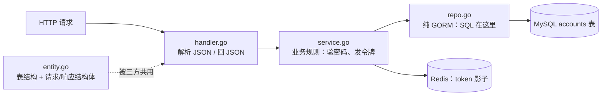
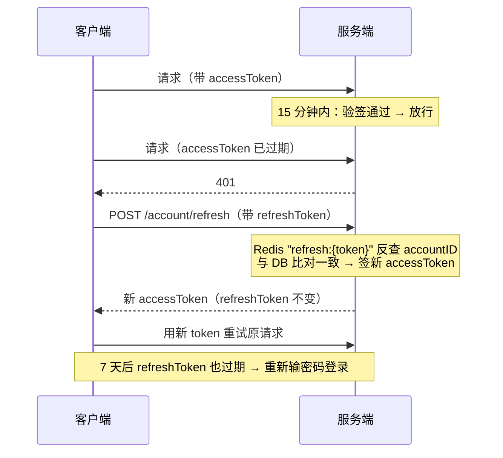

# 02 · 账号模块与同步请求链路

> 对象：`backend/internal/account/`（entity / handler / service / repo）+ `internal/auth/jwt.go` + `internal/middleware/jwt/jwt.go` + `internal/middleware/ratelimit/ratelimit.go`
> 目标：理解一次 HTTP 请求从进来到落库的完整路径，以及「四层拆分」在代码里的实际形态。
> 读完要能回答：AccessToken 和 RefreshToken 怎么配合？为什么 RefreshToken 要存 Redis 而不是只存 Account 表？限流是怎么挂进去、怎么计数的？
>
> **本篇只讲同步链路骨架。双 Token 的判活模型、软硬鉴权、降级矩阵与面试追问，见 `05-双Token鉴权与软硬鉴权.md`。**

---

## 0. 这个模块管什么

账号模块是**纯同步链路**的样板：没有 MQ、没有异步任务，一个 HTTP 请求进来，要么成功要么报错，结果立刻返回。

对外暴露的接口（见 `router.go` 43-59 行）：

| 路由 | 处理函数 | 是否需要登录 | 限流 |
|---|---|---|---|
| POST /account/register | `CreateAccount` | 否 | 5 次/小时/IP |
| POST /account/login | `Login` | 否 | 10 次/分钟/IP |
| POST /account/changePassword | `ChangePassword` | **是**（校验旧密码） | 5 次/小时/账号 |
| POST /account/findByID | `FindByID` | 否 | 无 |
| POST /account/findByUsername | `FindByUsername` | 否 | 无 |
| POST /account/refresh | `Refresh` | 否（校验 refresh_token） | 无 |
| POST /account/logout | `Logout` | **是** | 无 |
| POST /account/rename | `Rename` | **是** | 无 |
| POST /account/uploadAvatar | `UploadAvatar` | **是** | 无 |
| POST /account/updateProfile | `UpdateProfile` | **是** | 无 |

「是否需要登录」由路由挂在哪个组决定：`accountGroup` 下的公开接口直接注册；`protectedAccountGroup` 先用 `jwt.JWTAuth(...)` 中间件拦截，验不过就 401。

---

## 1. 四个文件的分工



| 文件 | 一句话职责 | 类比 |
|---|---|---|
| `entity.go` | 定义 `Account` 表结构 + 所有请求/响应的 struct（json tag 在这） | 数据字典 |
| `handler.go` | HTTP 边界：`ShouldBindJSON` 解析请求体 → 调 service → 把错误翻译成状态码 | 收发室 |
| `service.go` | 业务规则全在这：bcrypt 验密码、签发双 Token、写 Redis | 大脑 |
| `repo.go` | 只写 SQL（GORM），不做任何业务判断 | 手 |

**为什么没有 main 函数也能跑？** `internal/account` 是库包，它的入口在 `router.go` 40-46 行被「装配」：

```go
accountRepository := account.NewAccountRepository(db)
accountService := account.NewAccountService(accountRepository, cache)
accountHandler := account.NewAccountHandler(accountService)
...
accountGroup.POST("/login", loginLimiter, accountHandler.Login)  // 登记，不是调用
```

`accountHandler.Login` 后面没有括号——这是把函数本身登记进 Gin 路由表。`main.go` 的 `r.Run(":8080")` 启动监听后阻塞，之后每个请求由 Gin 按路由表**反向调用** handler。调用方向：

```
启动阶段（自上而下组装）：main → SetRouter → NewHandler → NewService → NewRepository
运行阶段（框架反向调用）：Gin → handler → service → repo → DB
```

---

## 2. 一次登录的完整链路

主线就是 [service.go 的 `Login`](file:///d:/fronted-projects/feedsystem_video_go-main/backend/internal/account/service.go)，跳出去的每个函数看完跳回来即可。

```bash
curl -X POST http://localhost:8080/account/login \
  -H "Content-Type: application/json" \
  -d '{"username":"test1","password":"pass1234"}'
```

### 第 1 步：Gin 匹配路由，先过限流器

`router.go` 第 46 行的登记决定了执行顺序：**先进 `loginLimiter`，通过才进 `Login`**。限流器去 Redis 把 `feedsystem:ratelimit:account_login:你的IP` 计数 +1，1 分钟内超过 10 次直接回 429，业务函数不执行。（限流细节见第 5 节）

### 第 2 步：JSON 变成 Go 变量（handler.go）

```go
func (h *AccountHandler) Login(c *gin.Context) {
    var req LoginRequest
    if err := c.ShouldBindJSON(&req); err != nil {   // 按 json tag 把请求体填进 req
        c.JSON(apierror.ClassifyHTTPStatus(err), gin.H{"error": err.Error()})
        return
    }
    account, err := h.accountService.FindByUsername(c.Request.Context(), req.Username)
    ...
    accessToken, refreshToken, err := h.accountService.Login(c.Request.Context(), req.Username, req.Password)
```

执行完 `ShouldBindJSON`，代码里有了 `req.Username = "test1"`、`req.Password = "pass1234"`。
`c.Request.Context()` 是本次请求的上下文，一路传到 GORM——客户端中途断开，下游 SQL 会跟着取消。

### 第 3 步：查 MySQL 拿用户（service → repo）

service 层入口：

```go
func (as *AccountService) Login(ctx context.Context, username, password string) (string, string, error) {
    account, err := as.FindByUsername(ctx, username)   // 转发给 repo
    if err != nil {
        return "", "", err                              // 用户不存在 → 结束
    }
```

真正生成 SQL 的地方（repo.go）：

```go
func (ar *AccountRepository) FindByUsername(ctx context.Context, username string) (*Account, error) {
    var account Account
    if err := ar.db.WithContext(ctx).Where("username = ?", username).First(&account).Error; err != nil {
        return nil, err                                 // 查不到返回 gorm.ErrRecordNotFound
    }
    return &account, nil
}
```

等价 SQL：`SELECT * FROM accounts WHERE username='test1' LIMIT 1;`
查出的 `account.Password` 是注册时存的 bcrypt 密文（`$2a$10$...`），不是明文。

### 第 4 步：验密码（service.go）

```go
if err := bcrypt.CompareHashAndPassword([]byte(account.Password), []byte(password)); err != nil {
    return "", "", err                                  // 密码不对 → 结束
}
```

bcrypt 把输入的明文按存储密文里的盐重新哈希一遍再比对，是单向校验，数据库永远不存明文。

### 第 5 步：生成两把令牌（service.go → auth/jwt.go）

```go
accessToken, err := auth.GenerateToken(account.ID, account.Username)
refreshToken, err := auth.GenerateRefreshToken(account.ID)
```

**AccessToken** 是 HS256 签名的 JWT（auth/jwt.go 42-58）：

```go
claims := Claims{
    AccountID: accountID,                                // 令牌里写着"你是谁"
    Username:  username,
    RegisteredClaims: jwt.RegisteredClaims{
        ExpiresAt: jwt.NewNumericDate(now.Add(15 * time.Minute)),  // 15 分钟过期
    },
}
token := jwt.NewWithClaims(jwt.SigningMethodHS256, claims)
return token.SignedString(jwtSecret())                   // 密钥来自环境变量 JWT_SECRET
```

**RefreshToken** 不是 JWT，是 32 字节加密随机数的 hex（auth/jwt.go 60-66）：

```go
b := make([]byte, 32)
rand.Read(b)
return hex.EncodeToString(b), nil                        // → 64 个随机字符，不透明
```

### 第 6 步：两把令牌写进 MySQL（service → repo）

```go
as.accountRepository.Login(ctx, account.ID, accessToken, refreshToken)
```

repo 层（repo.go 74-79）：

```go
ar.db.WithContext(ctx).Model(&Account{}).Where("id = ?", id).
    Updates(map[string]interface{}{"token": token, "refresh_token": refreshToken})
```

等价 SQL：`UPDATE accounts SET token='eyJhbG...', refresh_token='a3f9c2...' WHERE id=1;`
**效果：新令牌覆盖旧令牌**——旧设备手里的 token 立刻作废（单会话）。

### 第 7 步：令牌影子写进 Redis（service.go 132-145）

```go
if as.cache != nil {          // Redis 没启动就跳过整段，登录照样成功
    cacheCtx, cancel := context.WithTimeout(ctx, 50*time.Millisecond)  // 缓存操作最多等 50ms
    defer cancel()

    as.cache.SetBytes(cacheCtx, as.cache.Key("account:%d", account.ID), []byte(accessToken), 24*time.Hour)
    as.cache.SetBytes(cacheCtx, as.cache.Key("account:%d:refresh", account.ID), []byte(refreshToken), 7*24*time.Hour)
    as.cache.SetBytes(cacheCtx, as.cache.Key("refresh:%s", refreshToken), []byte(strconv.FormatUint(uint64(account.ID), 10)), 7*24*time.Hour)
}
```

| Redis Key | 值 | TTL | 用途 |
|---|---|---|---|
| `account:{id}` | accessToken | 24h | JWT 中间件比对"这是不是当前有效令牌" |
| `account:{id}:refresh` | refreshToken | 7 天 | 登出时对称删除用 |
| `refresh:{refreshToken}` | accountID | 7 天 | /refresh 接口反查"这令牌属于谁" |

三处写失败都只 `log.Printf` 不返回错误——Redis 挂了不影响登录（降级设计）。

### 第 8 步：返回 JSON（handler.go 132）

```go
c.JSON(200, LoginResponse{Token: accessToken, RefreshToken: refreshToken, AccountID: account.ID, Username: account.Username})
```

```json
{"token":"eyJhbG...","refresh_token":"a3f9c2...","account_id":1,"username":"test1"}
```

> 小观察：handler 的 `Login` 在第 122 行先调了一次 `FindByUsername`（为了拿 `account.ID` 填响应），service 的 `Login` 内部又查了一次——同一请求查了两遍用户表，是可优化点，不影响理解。

---

## 3. 注册、改名、改密的三个细节

### 注册 = 明文 → bcrypt 哈希 → INSERT

```go
passwordHash, err := bcrypt.GenerateFromPassword([]byte(account.Password), bcrypt.DefaultCost)  // DefaultCost=10，2^10 轮
account.Password = string(passwordHash)
as.accountRepository.CreateAccount(ctx, account)
```

数据库只存哈希，明文从不落库。

### 改名必须换发新 token

`Username` 写在 JWT 的 claims 里，改名后旧 token 里的用户名就错了。所以 `Rename` 先签新 token，再用**事务**把 username 和 token 一起更新（repo.go `RenameWithToken`）：

```go
return ar.db.WithContext(ctx).Transaction(func(tx *gorm.DB) error {
    // UPDATE username ...; UPDATE token ...   要么都成功要么都回滚
})
```

用户名撞车靠 MySQL 错误码 1062（唯一键冲突）捕获，转成 `ErrUsernameTaken`，handler 映射为 409。

### 改密 = 验旧密码 → 哈希新密码 → 强制登出

`ChangePassword` 最后一步调用 `Logout`：清空该用户在 DB 的 token 两列 + 删除 Redis 三个 key。所有设备的旧令牌立即失效。

---

## 4. 双 Token 机制

### 分工

| | AccessToken | RefreshToken |
|---|---|---|
| 形态 | HS256 JWT，自包含（payload 里有 account_id/username） | 64 字符随机串，不透明 |
| 有效期 | 15 分钟 | 7 天 |
| 出现频率 | 每个 API 请求都携带 | 仅调 `/account/refresh` |
| 验证方式 | 验签 + 与存储的当前 token 比对 | 必须回服务端存储比对 |

### 配合流程



**为什么要两个？** AccessToken 15 分钟一换，泄露窗口小；但只有它的话用户每 15 分钟要重输密码。RefreshToken 让续命无感化。**RefreshToken 不做成 JWT**，因为它只在服务端比对，不需要携带 claims，随机串更简单、不可伪造。

### 单会话：JWT 中间件多做的一步

JWT 本身无状态、签出去收不回。`middleware/jwt/jwt.go` 的 `check()` 在验签后**多做一次比对**：

```go
b, err := cache.GetBytes(cacheCtx, key)     // key = "account:{id}"
if err == nil {
    if string(b) != tokenString {
        c.AbortWithStatusJSON(401, gin.H{"error": "token has been revoked"})  // 旧 token 被踢
        return
    }
    ...
}
// Redis 查不到 → 降级查 DB 的 token 列做同样比对
```

因为每次登录覆盖存储的 token，新设备一登录，旧设备的 token 立即 401。通过后 `c.Set("accountID", ...)`，后续 handler 用 `getAccountID(c)` 直接取，不用再解析 token。

---

## 5. 限流器：固定窗口计数

### 定义与挂载（router.go 32-46）

```go
loginLimiter := ratelimit.Limit(cache, "account_login", 10, time.Minute, ratelimit.KeyByIP)
registerLimiter := ratelimit.Limit(cache, "account_register", 5, time.Hour, ratelimit.KeyByIP)

accountGroup.POST("/register", registerLimiter, accountHandler.CreateAccount)
accountGroup.POST("/login", loginLimiter, accountHandler.Login)
```

`Limit` 五个参数：Redis 客户端 / 计数器前缀 / 窗口内最大次数 / 窗口长度 / **计数维度函数**。

### 计数维度决定"防谁"（ratelimit.go 58-72）

- `KeyByIP`：登录/注册还没登录态，只能按 IP，防"同一 IP 疯狂试密码"
- `KeyByAccount`：点赞/评论/关注用，挂在 JWT 中间件之后（组级中间件先于路由级执行），此时 `accountID` 已被塞进 context，防"一个账号刷接口"

### 中间件主体（ratelimit.go 24-47）

```go
return func(c *gin.Context) {
    if cache == nil || keyFunc == nil || maxRequests <= 0 || window <= 0 {
        c.Next(); return                    // 降级路径①：配置无效直接放行
    }
    subject, ok := keyFunc(c)
    if !ok { c.Next(); return }             // 降级路径②：取不到维度放行

    key := buildKey(keyPrefix, subject)     // "feedsystem:ratelimit:account_login:192.168.1.10"
    count, err := cache.IncrementWithExpire(c.Request.Context(), key, window)
    if err != nil { c.Next(); return }      // 降级路径③：Redis 报错放行

    if count > maxRequests {
        c.AbortWithStatusJSON(429, ...)     // Abort：后续 handler 不再执行
        return
    }
    c.Next()
}
```

三条降级路径全部放行：**限流故障不阻塞业务**，符合项目"API 进程对 Redis 降级"的硬约束。

### 计数的原子性：Lua 脚本（redis.go 90-96）

```lua
local count = redis.call("INCR", KEYS[1])
if count == 1 then
  redis.call("PEXPIRE", KEYS[1], ARGV[1])
end
return count
```

- **为什么用 Lua**：`INCR` + `EXPIRE` 拆成两条命令，中间崩溃 key 就永不过期，该 IP 被永久锁死。Lua 在 Redis 内部原子执行。
- **为什么 `count == 1` 才设过期**：只在窗口第一次请求时设 TTL。每次都设就变成滑动窗口、永不清零。`redis_test.go` 的 `TestIncrementWithExpireSetsTTLWithoutExtendingWindow` 专门锁定这个行为。

### 一次限流判断示例（10 次/分钟）

```
第 1 次   → INCR → count=1，PEXPIRE 60s → 1>10? 否 → 进业务
第 10 次  → INCR → count=10            → 10>10? 否 → 进业务
第 11 次  → INCR → count=11            → 是 → 429，业务不执行
60 秒后 key 自动消失 → 下次 count=1，新窗口开始
```

注意：**计数在验密码之前**，密码输错也占配额——这正是防暴力破解的意义。

### 已知短板

1. **固定窗口边界突刺**：第 59 秒打 10 次 + 第 61 秒（新窗口）再打 10 次，2 秒内过了 20 次。要严格限需滑动窗口（ZSET 存时间戳）或令牌桶，成本高，登录场景不需要。
2. **按 IP 可能误伤**：NAT 后整栋楼共用一个公网 IP。所以注册限得更严（5 次/小时）——注册被刷的代价是脏数据，登录被刷只是打扰。

---

## 6. Redis 里的 key 清单（账号相关）

| Key 模式 | 值 | TTL | 写入时机 | 删除时机 |
|---|---|---|---|---|
| `account:{id}` | accessToken | 24h | 登录 / 改名 / refresh | 登出、改密 |
| `account:{id}:refresh` | refreshToken | 7d | 登录 | 登出、改密 |
| `refresh:{refreshToken}` | accountID | 7d | 登录 | 登出、改密 |
| `feedsystem:ratelimit:account_login:{ip}` | 计数 | 60s | 每次登录请求 | 自动过期 |
| `feedsystem:ratelimit:account_register:{ip}` | 计数 | 1h | 每次注册请求 | 自动过期 |

---

## 7. 两个核心问题的答案

### Q1：AccessToken 和 RefreshToken 怎么配合？

客户端每次请求带 AccessToken；15 分钟过期收到 401 后，自动拿 RefreshToken 调 `/account/refresh` 换新 AccessToken 并重试；7 天后 RefreshToken 过期才真正重新登录。AccessToken 短命是为了缩小泄露窗口，RefreshToken 长命是为了免密续命，两者配合兼顾安全与体验。

### Q2：为什么 RefreshToken 要存 Redis 而不是只存 Account 表？

本项目**两处都存了**：DB 的 `refresh_token` 列是降级兜底，Redis 是主路径。Redis 不可替代的三条原因：

1. **查询模式**：验证 refresh token 是反查"这串字符属于谁"。Account 表该列无索引，降级路径（`RefreshAccessToken` 里的 `FindAll` + for 循环）是 O(n) 全表扫描；Redis 的 `refresh:{token}` 是 O(1) 点查。
2. **TTL 是硬需求**：7 天自动过期。Redis 原生 `EXPIRE` 零成本；MySQL 要加过期字段 + 定时清理任务。
3. **吊销必须即时**：登出/改密要求立刻生效，Redis `DEL` 即时；只靠 DB 则 JWT 校验每次都打 MySQL。

---

## 8. 自测清单

- [ ] 不看代码，画出登录请求从路由到响应的 8 个步骤
- [ ] 解释 `accountHandler.Login` 后面为什么不加括号
- [ ] 说明 `c.AbortWithStatusJSON` 和 `c.JSON` 的区别对中间件链的影响
- [ ] 说出 Redis 里 `account:{id}`、`refresh:{token}` 两个 key 分别给谁用
- [ ] 解释为什么限流 Lua 脚本里 `count == 1` 才 `PEXPIRE`
- [ ] 实跑一遍：注册 → 登录 → 带 token 调 `updateProfile` → 调 `refresh` 换新 token
- [ ] 在 MySQL 里验证：登录后 `accounts` 表的 `token`/`refresh_token` 有值，`password` 是 `$2a$10$` 开头
