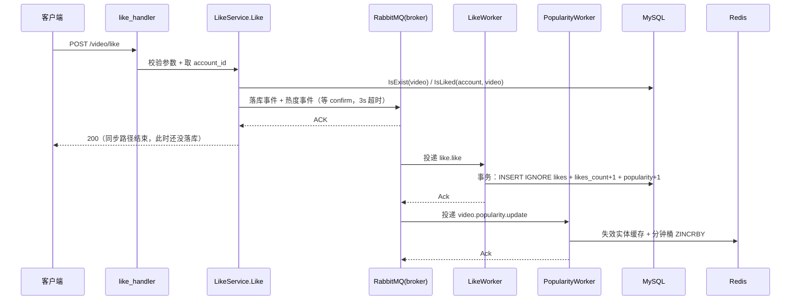
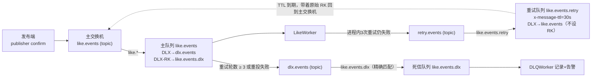
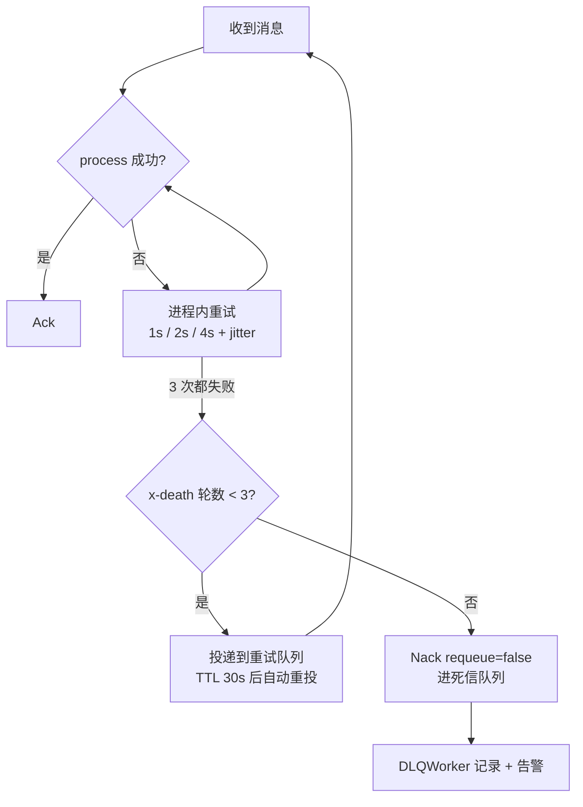

# 04 · 事件驱动异步化与最终一致性

> 对象：`backend/internal/middleware/rabbitmq/`（拓扑与发布端）+ `backend/internal/worker/`（消费端）+ `backend/internal/video/{like,comment}_service.go`（同步路径与降级）
> 目标：理解一次点赞/评论请求为什么被拆成「同步一小段 + 异步一大段」，以及异步链路靠什么保证「不丢、不重、最终一致」。
> 读完要能回答：为什么不直接同步写完？MQ 挂了会怎样？消息重复投递会怎样？重试失败的消息去了哪？

---

## 0. 这个模块管什么

账号模块（02）是**纯同步**的样板：一个请求进来，要么成功要么报错，结果立刻可见。
本模块是它的反面——**同步路径只做「能不能做」的判断，「做」这件事交给异步**。

以点赞为例，一次操作涉及的副作用有四种：

| 副作用 | 落在哪 | 一致性要求 | 能不能异步 |
|---|---|---|---|
| 写 `likes` 行 | MySQL | 强（不能多、不能少） | 能 |
| `videos.likes_count` +1 | MySQL | 强（必须和上面同步） | 能 |
| `videos.popularity` +1 | MySQL | 弱（准实时即可） | 能 |
| 热度分钟桶 ZINCRBY | Redis | 弱（丢了只是热度偏一点） | 能 |

既然四种都能异步，同步路径就只剩下**校验**：参数合法吗？视频存在吗？点过赞了吗？
剩下的全部变成消息。

**拆分原则：按副作用类型拆，不按接口拆。**

```
一次点赞 → 两类消息
  ├─ 落库事件  like.events / like.like        → LikeWorker       → MySQL（强一致）
  └─ 热度事件  video.popularity.events / ...  → PopularityWorker → Redis（准实时）
```

拆开的好处是**故障域隔离**：Redis 挂了，点赞照样能落库；MySQL 慢了，热度事件也不会被堵在落库队列里排队。如果合成一条消息由一个 Worker 串行处理，任何一环慢/挂都会拖累另一环。

---

## 1. 一次点赞的完整链路



注意同步路径**只等 confirm，不等消费**。所以接口返回 200 时，`likes` 表里可能还没有这一行 —— 这就是「最终一致」的字面含义。

---

## 2. 队列拓扑：主队列 / 重试队列 / 死信队列

每一类事件都有三个队列，声明入口统一在 `rabbitmq/topic.go` 的 `Topic.Declare`（`topics.go:49`）：



| 队列 | 命名 | 关键参数 | 作用 |
|---|---|---|---|
| 主队列 | `like.events` | `x-dead-letter-exchange=dlx.events`<br/>`x-dead-letter-routing-key=like.events.dlx` | 正常消费 |
| 重试队列 | `like.events.retry` | `x-message-ttl=30s`<br/>`x-dead-letter-exchange=like.events`<br/>**故意不设** `x-dead-letter-routing-key` | TTL 到期自动重投 |
| 死信队列 | `like.events.dlx` | 绑定键 = `like.events.dlx`（精确） | 兜底观察/告警 |

两个容易踩空的细节：

1. **重试队列为什么不设 `x-dead-letter-routing-key`？**
   RabbitMQ 的规则是「没指定死信路由键时，沿用消息原始 routing key」。于是一条 `like.like` 的消息在重试队列里躺 30 秒后，会带着 `like.like` 回到 `like.events` 交换机，被主队列的 `like.*` 绑定接住 —— 天然完成重投，不需要代码计算路由键，也不需要定时任务。

2. **死信队列为什么必须用精确路由键？**
   `dlx.events` 是所有队列共用的 topic 交换机。之前每个 `<queue>.dlx` 都用 `#` 绑定，等于把 topic 交换机当 fanout 用：**一条死信会被复制到所有死信队列**。改成精确 key 后，A 队列的死信只会进 `A.dlx`。

> ⚠️ 运维注意：改 `x-dead-letter-routing-key` 属于改队列参数，已存在的队列会报 `PRECONDITION_FAILED (406)`。上线前需要删除旧队列（或改名），否则声明失败。

---

## 3. 同步路径逐行

`internal/video/like_service.go:24` `LikeService.Like`：

```go
// 1) 参数校验
if like.VideoID == 0 || like.AccountID == 0 { return errors.New(...) }
// 2) 视频存在吗
ok, err := s.VideoRepo.IsExist(ctx, like.VideoID)
// 3) 重复点赞校验（同步挡掉大部分重复，但不依赖它保幂等）
isLiked, err := s.repo.IsLiked(ctx, like.VideoID, like.AccountID)
// 4) 发两条消息，各自等 confirm
if err := s.likeMQ.Like(ctx, like.AccountID, like.VideoID); err == nil { mysqlEnqueued = true }
if err := s.popularityMQ.Update(ctx, like.VideoID, 1); err == nil { redisEnqueued = true }
if mysqlEnqueued && redisEnqueued { return nil }
// 5) 降级：哪条没发出去就同步补哪条
```

**同步耗时 = 校验（2 次 MySQL 读）+ 2 次 publish confirm**。没有写 MySQL、没有写 Redis。

第 3 步的 `IsLiked` 是「读后写」，并发下天然有窗口（两个请求同时读到「未点赞」）。它只是**用户体验层面的快速失败**，真正的幂等由消费端的唯一索引兜底 —— 这一点很重要：**永远不要把「同步判重」当成幂等保证**。

---

## 4. 幂等：三种写法，为什么选「唯一索引 + RowsAffected」

消息系统只能保证 **至少一次投递（at-least-once）**，重复投递是必然事件，不是小概率事件。所以消费端必须幂等。

| 写法 | 例子 | 问题 |
|---|---|---|
| 先 SELECT 再 INSERT | `if !exists { insert }` | 检查和写入之间有窗口，并发/重试下照样重复 |
| INSERT 后捕获 1062 | `if err.(*MySQLError).Number == 1062 { return nil }` | 能去重，但把「已存在」和「本次真写入」混为一谈；后面再加任何副作用都无法判断是否该执行 |
| **INSERT IGNORE + RowsAffected** ✅ | `res.RowsAffected == 0 → 已处理过` | 一次 SQL 完成「去重 + 判断是否新增」，且天然并发安全 |

项目里现在统一用第三种（`like_repo.go:22`、`comment_repo.go:31`、`social/repo.go`）：

```go
res := tx.Clauses(clause.Insert{Modifier: "IGNORE"}).Create(&Like{VideoID: v, AccountID: a})
if res.RowsAffected == 0 {
    return nil // 重复投递，什么都不做（计数也绝不能加第二次）
}
```

**幂等键从哪来？**

| 事件 | 幂等键 | 位置 |
|---|---|---|
| 点赞 | `(video_id, account_id)` 联合唯一索引 `idx_like_video_account` | `video/like_entity.go` |
| 关注 | `(follower_id, vlogger_id)` 联合唯一索引 | `social/entity.go` |
| 评论 | `event_id` 唯一索引 `idx_comment_event_id` | `video/comment_entity.go` |
| 通知 | `event_id` 唯一索引 `idx_notification_event_id` | `worker/notificationworker.go` |

点赞/关注的幂等键是**业务天然唯一键**（一个人对一个视频只能点一次），不需要额外字段。
评论不行 —— 同一个人可以在同一个视频下发表两条一模一样的内容，业务上没有天然唯一键，所以必须引入 `event_id`。

`event_id` 由**发布端在发布前生成**（`rabbitmq.NewEventID()`，`rabbitMQ.go:136`），服务层无论最终走 MQ 还是降级直写，都把同一个 ID 写进 `comments.event_id`：

```go
// comment_service.go:26
if comment.EventID == nil {
    if eventID, err := rabbitmq.NewEventID(); err == nil { comment.EventID = &eventID }
}
// 同一个 eventID 既进消息体，也进本地 DB 行
```

> 为什么 `EventID` 用 `*string` 而不是 `string`？
> AutoMigrate 加列时历史行的值是 `NULL`，而 MySQL 唯一索引**允许多个 NULL**；如果用 `string`，历史行会全落成空串 `''` 并立刻违反唯一约束，导致建索引失败、服务起不来。

---

## 5. 事务：为什么「插行」和「计数」必须在同一个事务里

这是本模块最隐蔽的一个坑。看修复前的消费端逻辑：

```go
created, _ := likes.LikeIgnoreDuplicate(...)   // ① 插 likes 行
if !created { return nil }
videos.ChangeLikesCount(ctx, videoID, 1)       // ② likes_count + 1
videos.ChangePopularity(ctx, videoID, 1)       // ③ popularity + 1
```

三条独立 SQL。假设①成功、②因为锁等待超时失败：

1. 消息被重试（这是应该的）；
2. 重试时①命中唯一索引，`created == false`，直接 `return nil`；
3. **②永远没有机会再执行** → 这一个赞被永久性地少算一次。

一个号称「最终一致」的系统里，最不该出现的就是这种**永久偏差**。而且它不可观测：计数就是比实际少 1，没有任何报错。

修复方式是把三者绑进一个事务（`like_repo.go:22`）：

```go
return r.db.WithContext(ctx).Transaction(func(tx *gorm.DB) error {
    // 插行（幂等）
    res := tx.Clauses(clause.Insert{Modifier: "IGNORE"}).Create(&Like{...})
    if res.RowsAffected == 0 { return nil }
    // 计数：与插行同事务
    bumpVideoColumn(tx, videoID, "likes_count", 1)
    return bumpVideoColumn(tx, videoID, "popularity", 1)
})
```

要么「行 + 计数」一起生效，要么都不生效。此时重试才是安全的：重试 → 插行被唯一索引挡住 → 什么都不做 → 数据已经是对的。

**推论：只要「写业务行」和「更新冗余计数」不在同一事务，重试就一定会产生永久偏差。** 评论同理（`comment_repo.go:31` 把插评论和 `popularity + 1` 放进同一事务）。

计数用 `GREATEST(col + ?, 0)` 兜底，避免取消点赞把计数刷成负数。

---

## 6. 三级容错

所有 Worker 共用 `worker/retry.go` 的 `Consumer`（`retry.go:39` / `retry.go:69`），业务 Worker 只提供一个 `process` 函数。



| 级别 | 机制 | 解决什么 | 上限 |
|---|---|---|---|
| 1 | 进程内指数退避 + jitter | 瞬时抖动（网络闪断、锁等待、连接断开） | 3 次 |
| 2 | TTL 重试队列延迟重投 | 较持久故障（DB 主从切换、Redis 重启） | 3 轮（用 `x-death.count` 计数） |
| 3 | 死信队列 | 注定失败的消息（坏数据、逻辑 bug） | 人工/工具处理 |

三个关键点：

- **jitter 是必须的**。`wait/2 + rand(wait/2)`，避免同一批失败消息在同一秒集体重试，把刚恢复的下游再打一次尖峰。
- **重试计数读 `x-death`**（`dlx.go:59` `GetRetryCount`）。消息每次经过重试队列的 TTL 死信，RabbitMQ 会自己累加 `x-death.count`，不需要业务侧存状态。
- **任何时候都不 Ack 掉失败的消息**。修复前的代码是「重试 3 次后 `_ = d.Ack(false)` 丢弃」—— 这是把「至少一次」降级成了「最多一次」，死信交换机形同虚设。现在的路径是 `Nack(requeue=false)`，让消息走 `x-dead-letter-exchange` 进它自己的死信队列。

坏消息（JSON 解析失败、字段缺失）是**例外**：`process` 返回 `nil` 直接 Ack 丢弃。因为它重试一万次也解不开，留着只会占满重试次数再进死信，制造无意义的告警。

---

## 7. 降级：MQ 挂了会怎样

`like_service.go` / `comment_service.go` 里的降级是**按消息粒度**的：哪条没发出去就同步补哪条，不是「MQ 一挂整体切同步」。

| 故障 | 同步路径表现 | 数据结果 |
|---|---|---|
| MQ 整体不可用 | `publish` 返回 err → 事务直写 MySQL + 直写 Redis | 一致（同步就写完了） |
| confirm 超时（消息其实已入队） | 降级直写；Worker 随后也会写一次 | **幂等，只写一次**（靠唯一索引） |
| broker nack | 同上 | 同上 |
| Worker 进程挂了 | 接口照常 200，消息在队列堆积 | 延迟一致，进程恢复后追平 |
| MySQL 挂了 | 同步校验 `IsExist` 失败 → 500 | 消息靠重试队列兜底 |
| Redis 挂了 | 热度事件照发，不影响落库 | 热度丢精度；`PopularityWorker` 处理失败会走重试 |

**降级为什么复用消费端的同一个 `ApplyLike`？**
因为「publish 成功但 confirm 超时」这个窗口无法消除：消息其实已经在队列里，Worker 可能已经写完了，此时降级再写一次必须是幂等的。让两条路径走**同一个事务 + 同一套 `INSERT IGNORE` 幂等**，比在 service 里另写一份降级逻辑安全得多 —— 两份实现必然有一处漏修。

同理，`UpdatePopularityCache` 现在**返回 error**（`video/popularity_cache.go`）。之前它吞掉 Redis 错误照样返回，Worker 于是照样 Ack：Redis 故障期间所有热度事件被静默丢弃，热榜根本谈不上「最终一致」。

---

## 8. 代码地图

| 文件 | 职责 |
|---|---|
| `rabbitmq/publisher.go` | 带 publisher confirm 的发布器；用 mutex 串行化「发布+等确认」 |
| `rabbitmq/rabbitMQ.go` | `DeclareTopic`（主队列 + 死信路由键）；`NewEventID` |
| `rabbitmq/retry.go` | 重试队列拓扑 + `RetryRouter`（把失败消息投到重试队列） |
| `rabbitmq/dlx.go` | 死信队列声明（精确绑定键）+ `GetRetryCount` |
| `rabbitmq/topics.go` | 四类事件的拓扑注册表（消除进程间常量重复） |
| `rabbitmq/{like,comment,social,popularity}MQ.go` | 各类事件的发布端，全部走 confirm |
| `worker/retry.go` | 统一消费骨架 `Consumer`：退避 → 重投 → 死信 |
| `worker/{like,comment,social,popularity}worker.go` | 业务 Worker，只实现 `process` |
| `worker/dlqworker.go` | 死信队列消费者（记录 + 告警点） |
| `video/like_repo.go` `ApplyLike/ApplyUnlike` | 事务 + 幂等的点赞写入 |
| `video/comment_repo.go` `ApplyPublish/ApplyDelete` | 事务 + `event_id` 幂等的评论写入 |
| `video/{like,comment}_service.go` | 同步校验 + 发布 + 降级 |
| `cmd/worker/main.go` | Worker 进程装配：拓扑 / 重试路由 / Worker / 死信消费者 |

---

## 9. 本次修正的问题（简历 ↔ 实现对照）

| # | 简历原话 | 实现原状 | 修正 |
|---|---|---|---|
| 1 | 「同步耗时只含校验与 MQ 发布确认」 | 点赞/评论/关注/热度**没有开 confirm**，只有时间线开了；`PublishJSON` 返回 nil 不代表 broker 收下 | 四类发布端统一走 `publisher`（`ch.Confirm` + `waitConfirm` 3s） |
| 2 | 「消费端幂等（唯一索引去重 + RowsAffected）」 | 点赞是**捕获 1062 错误码**（不是 RowsAffected）；评论**完全没有幂等键** | 统一 `INSERT IGNORE + RowsAffected`；评论加 `event_id` 唯一索引 |
| 3 | （隐含）落库与计数最终一致 | 插行与计数**不在同一事务**，重试被唯一索引挡住后计数永久少算 | `ApplyLike/ApplyUnlike/ApplyPublish` 全部事务化 |
| 4 | 「失败指数退避重试 3 次」 | 无 jitter；3 次后 **Ack 丢弃**，不进死信 | 加 jitter；改为「重试队列延迟重投 ≤3 轮 → 死信告警」 |
| 5 | （隐含）死信拓扑可用 | 所有 `<queue>.dlx` 用 `#` 绑定到同一个交换机 → **死信被广播到所有死信队列**；`GetRetryCount` 无人调用 | 精确路由键；`GetRetryCount` 用于终止重试 |
| 6 | 「由独立 Worker 分别消费互不影响」 | `PopularityWorker` **吞掉 Redis 错误后照样 Ack**，Redis 故障期间热度静默丢失 | `UpdatePopularityCache` 返回 error，失败照常重试 |
| 7 | （隐含）降级可靠 | 降级路径另写一份事务，与消费端两套逻辑，存在重复计数窗口 | 降级复用消费端同一 `ApplyXxx` |
| 8 | （架构描述）Worker 进程消费四类 | Worker 进程与 rabbitmq 包**各写一份队列常量**；通知 Worker 重试后 Ack 丢弃、无去重 | 统一 `Topic` 注册表；通知 Worker 走同一 `Consumer` + `event_id` 去重 |

顺带修掉一个编译错误：`rabbitmq/timelineMQ.go` 重写时丢失了 `TimelineEvent` 结构体定义（`outboxworker.go` 在用），已补回。

---

## 10. 自测题

1. 接口返回 200 了，为什么 `likes` 表里可能还没有数据？用户点完赞立刻刷新详情页会看到什么？
2. 「同一用户不能重复点赞」由几处保证？删掉消费端的唯一索引会怎样？
3. 插行和计数放在两个事务里，为什么一定会产生永久偏差？举个具体的时间线。
4. 重试队列为什么**不能**设置 `x-dead-letter-routing-key`？设了会发生什么？
5. 死信队列用 `#` 绑定会出什么问题？
6. confirm 超时了，但消息其实已经进了队列。系统靠什么保证不会重复计数？
7. 一条消息从失败到进死信队列，最长要多久？（提示：1+2+4 秒，×3 轮 + 30s TTL×3）
8. 为什么「坏消息」（JSON 解析失败）不重试直接 Ack？

---

## 11. 已知取舍与下一步

- **热度是准实时的**。落库与热度分属两条消息，可能出现「点赞数 +1 了但热榜还没动」的秒级窗口。
- **死信队列目前只打日志**（`worker/dlqworker.go`）。生产环境应换成告警（Prometheus counter / 企业微信），并提供按 `event_id` 重投的管理接口。
- **删除评论不减热度**。点赞取消会 `popularity -1`，评论删除不会 —— 语义上「热度」只统计正向行为，但和点赞不对称，若要对称需要在删除事件里带上 `video_id`。
- **`IsLiked` 的读后写窗口**没有加锁，重复点赞会返回「已点赞」错误但并发下可能漏判；不需要修，因为唯一索引会兜底，只是错误信息不一致。
- **API 进程内的 Outbox 投递器 / 时间线消费者 / 通知消费者**没有搬到 Worker 进程。理由是它们「单次处理轻、丢了可容忍、要求低延迟」，搬走要为多几个消费者复制整份 API；代价是 API 重启会影响 Outbox 投递的及时性（消息在库里，恢复后自动补发，不丢）。
