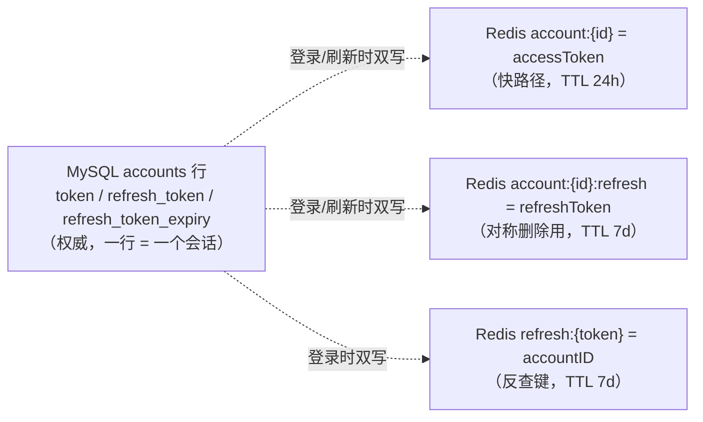
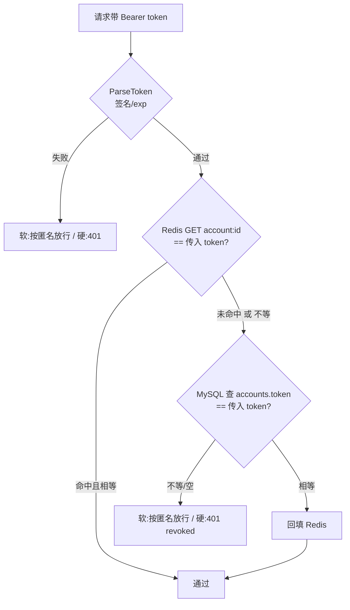

# 05 · 双 Token 鉴权与软硬鉴权

> 对象：`internal/auth/jwt.go` + `internal/account/*` + `internal/middleware/jwt/jwt.go` + `internal/worker/ssehub.go`（握手）+ 前端 `stores/auth.ts` / `api/client.ts`
> 目标：把「为什么这么设计」和「Redis 挂了会怎样」讲透，而不只是把代码念一遍。
> 读完要能回答：**纯无状态 JWT 到底缺了什么？为什么判活要查 Redis？软鉴权和硬鉴权的边界在哪？Redis 不可用时哪几条链路会退化、退化成什么样？**

---

## 0. 模块地图

| 文件 | 在本模块里的职责 |
|---|---|
| `internal/auth/jwt.go` | 签发/解析 Access Token（HS256 JWT）、生成 Refresh Token（随机串）；`AccessTokenTTL` / `RefreshTokenTTL` 两个常量是所有 TTL 的唯一来源 |
| `internal/account/entity.go` | `Account` 表结构：`token` / `refresh_token`(索引) / `refresh_token_expiry` |
| `internal/account/repo.go` | 纯 SQL：`Login`（覆盖写一行 = 一个会话）、`FindByRefreshToken`（索引等值查询）、`Logout`（清空两列） |
| `internal/account/service.go` | 业务规则：验密码、发双 Token、双写、吊销（`revokeTokens`）、刷新（`RefreshAccessToken`） |
| `internal/middleware/jwt/jwt.go` | `JWTAuth`（硬）、`SoftJWTAuth`（软）、`isActive`（判活）、`VerifyToken`（给 SSE 复用） |
| `internal/http/router.go` | 决定哪些路由挂硬鉴权、哪些挂软鉴权、限流挂在哪 |
| `internal/worker/ssehub.go` | SSE 握手复用 `VerifyToken`，避免长连接绕过吊销 |

---

## 1. 先想清楚：纯无状态 JWT 缺了什么

JWT 解决的是**「不用查库就知道你是谁」**。它有三件事：

1. **身份**：claims 里带 `account_id` / `username`；
2. **完整性**：HS256 签名，篡改即失效；
3. **时效**：`exp` 字段，过期即失效。

但它**解决不了「作废」**：签出去的 JWT 在 `exp` 之前永远有效，服务端没有地方记录「这张已经不要了」。于是：

- 用户点「登出」，旧 token 还能用 15 分钟；
- 用户改密码，攻击者手里的 token 还能用 15 分钟；
- 用户在别处登录（单会话互踢），旧设备的 token 还能用 15 分钟。

**结论：只要产品要求「即时吊销」，就必须在服务端留一份状态。** 本模块的选择是：JWT 继续承担 1/2/3，吊销能力由「服务端保存当前生效 token + 每次请求比对」补上。

这就是所谓的**有状态 JWT**——它保留了 JWT 的自包含身份信息，代价是每次鉴权多一次 Redis GET。这个取舍要在简历里明说，否则会被追问「那你用 JWT 图什么」。

> 图的是：身份信息不用查库、签名校验是本地 CPU 操作、以及 Refresh 链路可以做到无状态换发。真正必须落库的只有「这张 token 是否还是当前那一张」这一个比特。

---

## 2. 双 Token 的分工

|  | Access Token | Refresh Token |
|---|---|---|
| 形态 | HS256 JWT（自包含） | 32 字节随机数的 hex（不透明） |
| TTL | 15 分钟 | 7 天 |
| 谁校验 | 每个业务请求 | 只有 `/account/refresh` |
| 存在哪 | MySQL `accounts.token` + Redis `account:{id}` | MySQL `accounts.refresh_token` + Redis `refresh:{token}` / `account:{id}:refresh` |
| 泄漏影响 | 15 分钟（且可被即时吊销） | 7 天内可持续换 access，直到登出/改密 |
| 为什么是这个形态 | 要走无状态校验，必须自包含 | 要能吊销、要能过期，不透明串最省心（没有签名可伪造，只能靠查库比对） |

**为什么 Refresh 不是 JWT？** JWT 的价值是「不查库就能用」，而 Refresh 的每一次使用本来就必须查库（要判吊销、判过期）。用 JWT 反而多一层签名校验，还容易被误当成「无状态凭证」到处传。

两个 TTL 在 `auth/jwt.go` 里定义成常量，**Redis 的 TTL 和 MySQL 的 `refresh_token_expiry` 都从它派生**，不允许各处写死 `7*24*time.Hour`——否则改一处漏一处，就会出现「Redis 说过期了、MySQL 说没过期」的裂缝（这正是本次修掉的一个 bug）。

---

## 3. 存储设计：MySQL 存权威，Redis 存快路径



| Key / 列 | 值 | TTL | 用途 |
|---|---|---|---|
| `account:{id}` | 当前 access token | 24h | 判活快路径（比 token 本身 15min 长，纯影子） |
| `account:{id}:refresh` | 当前 refresh token | 7d | 登出/改密时对称删除 |
| `refresh:{token}` | accountID | 7d | 刷新时 O(1) 反查，**避免对 refresh_token 做全表扫描** |
| `accounts.token` | 当前 access token | — | 权威判活 + Redis 不可用时的回源 |
| `accounts.refresh_token` | 当前 refresh token（`size:64;index`） | — | 权威比对 + 降级查询走索引 |
| `accounts.refresh_token_expiry` | refresh 绝对过期时间 | — | **让「7 天」在 MySQL 侧也成立** |

为什么 `account:{id}` 的 TTL 是 24h 而不是 15min？它只是「当前生效 token 的影子」，token 自己带了 15 分钟 `exp`，JWT 解析那一步已经拦住了过期。TTL 给长一点是为了减少回源；真要吊销靠的是主动 `DEL`，不是等 TTL。

---

## 4. 五条链路

### 4.1 登录（`account/service.go` `Login`）

```text
FindByUsername → bcrypt 比对 → 生成 access(15m) + refresh(7d)
  → MySQL 覆盖写 token/refresh_token/refresh_token_expiry   ← 覆盖写 = 单会话互踢
  → Redis 删旧 refresh 反查键 + 写三个新 key（失败只 log，不阻断登录）
```

要点：**MySQL 写入成功就算登录成功**，Redis 是加速不是依赖。订单是「先权威后影子」，所以 Redis 抖动不会让登录 500。

### 4.2 鉴权（`middleware/jwt/jwt.go` `isActive`）



**为什么「Redis 里的值 != 传入 token」不是直接拒绝，而是回源 MySQL？**
因为 MySQL 才是权威。登录时如果 Redis 写失败（网络抖动、OOM 淘汰）而 MySQL 写成功，Redis 里躺着上一张旧 token——此时用户的**新** token 会被 Redis 判为「不是当前那张」。若直接拒绝，用户刚登录就被 401。回源 MySQL 既能救回合法 token，又不牺牲吊销能力（登出时两侧都删，吊销依然即时）。

### 4.3 刷新（`account/service.go` `RefreshAccessToken`）

```text
1) Redis 主路径：GET refresh:{token} → accountID        （O(1)，TTL 天然表达 7 天）
2) Redis 未命中/不可用 → MySQL 降级：FindByRefreshToken  （refresh_token 上的二级索引）
3) 两条路径汇合后统一校验：accounts.refresh_token == 传入 且 未过 refresh_token_expiry
4) 签发新 access → MySQL UpdateToken → 回填 Redis account:{id}
```

三个设计点：

- **必须保留第 3 步的 MySQL 比对。** 只信 Redis 反查键的话，一旦登出时 `DEL` 失败，被吊销的 refresh 就能继续换 access。
- **降级路径不能全表扫描。** 旧实现是 `FindAll()` 把所有账号读进内存再 `for` 比对，refresh 频率一高就是 DB 灾难（顺带把全表密码哈希读进内存）。
- **两条路径都要回填 `account:{id}`。** 旧实现的降级分支漏了回填，导致降级成功后每个请求都要回源 MySQL 判活。

### 4.4 登出 / 改密（`revokeTokens`）

```text
mustClear(account:{id})           一级 DEL → 二级重试 → 三级写空哨兵
mustClear(account:{id}:refresh)   同上
mustClear(refresh:{旧refresh})    同上
MySQL 清空 token + refresh_token  → 失败则报错

改密额外一步：bcrypt 验旧密码 → 写新密码 → revokeTokens（改密即吊销）
```

**两侧都要清。** 只删 Redis：Redis 故障期间的请求会回源到还没清的 MySQL，旧 token 又活了。只清 MySQL：Redis 里残留的旧 token 仍会被快路径判为有效。顺序上先让 Redis 失效再清 MySQL，避免出现「MySQL 已吊销、Redis 仍放行」的窗口。

**而且清 Redis 绝不能 best-effort**（详见下一节）。改密接口本身也必须**登录态 + 限流**：否则知道用户名的人就能对着接口无限次试旧密码。

### 4.4-bis 「写 best-effort、读却全信」陷阱 —— 本模块最致命的坑

先看判活的短路：

```go
// middleware/jwt/jwt.go isActive
if err == nil && len(b) > 0 && string(b) == tokenString {
    return true        // ← Redis 命中且相等就直接放行，不查 MySQL
}
```

再看原本的写路径：

```go
// 旧代码 service.go
if err := as.cache.Del(cacheCtx, key); err != nil {
    log.Printf("failed to del cache: %v", err)   // ← 失败只打日志，然后照常往下走
}
return as.accountRepository.Logout(ctx, account.ID)   // ← MySQL 清空，返回成功
```

**写允许失败，读却完全信任它** —— 方向就错了。推演：

```text
1. 登录            MySQL: token=T1     Redis: account:1=T1
2. 登出，DEL 失败   MySQL: token=""     Redis: account:1=T1   ← 脏值赖着不走
3. 客户端拿到 200 "account logged out"，以为已登出
4. 攻击者持 T1 请求 → isActive 第一步命中且相等 → return true → 放行 ❌
5. 直到那个 24h TTL 自然过期
```

同一漏洞的另一面是**单会话互踢失效**：新设备登录时 `SET` 新 token 失败、Redis 里还是旧值，旧设备照样在线。

> **为什么 refresh 侧没这个洞？** `RefreshAccessToken` 无论走 Redis 还是 MySQL，最后都强制回 MySQL 比对 `accounts.refresh_token`。access 侧的「命中即放行」短路才是根因 —— 它为了省一次 SQL，把 Redis 从「加速」抬成了「信任源」。

**修法是让「不可能残留可放行的旧值」成为不变量**，而不是指望 Redis 每次都写成功：

```go
// setCurrentToken：更新 access token 快路径
// 只有两种可接受结果 —— 写进新值，或者把 key 清掉让后续回源 MySQL
if err := cache.SetBytes(ctx, key, []byte(token), auth.AccessTokenTTL); err != nil {
    as.mustClear(ctx, key)      // 写不进去就把旧值删掉，绝不留着
}

// mustClear：三级降级保证旧值一定消失
//   ① DEL → ② 重试一次 DEL → ③ 写空哨兵（空串不可能等于任何真实 token，必然穿透回源）
// 三级都失败说明 Redis 整体不可用，而那时 GET 同样失败、一样回源 MySQL
```

配套三条约束：

1. **所有会改写 `accounts.token` 的路径**都要收敛到这两个 helper：`Login`（覆盖写）/ `RefreshAccessToken`（`UpdateToken`）/ `Rename`（重签）/ `Logout`（清空）/ 改密 → `revokeTokens`。漏一条就漏一个洞口。
2. **快路径 TTL 从固定 24h 改为「token 剩余寿命」**（`tokenRemainingTTL`）：万一再出现不一致，残留窗口上限是 15 分钟而非 24 小时。这是最后一道兜底。
3. `Logout` 的「MySQL 已空就提前 return」分支**必须先补一次 Redis 清理**，否则上一次清理失败留下的脏值会赖到 TTL 到期。

一句话原则：**不一致时必须往「拒绝 / 回源」倒，绝不能往「放行」倒。** 宁可让用户多等一次 SQL，也不能让已吊销的凭证继续通行。

### 4.5 前端续期（`api/client.ts`）

`postJson` 在收到 401 时（且不是刷新接口本身）触发一次 `tryRefresh()`，成功后用新 token 重放原请求；并发请求共享同一个 `refreshPromise`，避免惊群。刷新失败 → `clearTokens()`。

---

## 5. 软硬鉴权：一张表看清边界

|  | `JWTAuth`（硬） | `SoftJWTAuth`（软） |
|---|---|---|
| 用在哪 | 写接口、必须登录才能看的接口（点赞/评论/关注/上传/私信/登出/改密…） | `/feed` 公开列表（listLatest / listLikesCount / listByPopularity / listByTag） |
| 无 Authorization | 401 | 匿名放行 |
| token 过期 / 签名非法 | 401 | **匿名放行** |
| token 已吊销 | 401 | **匿名放行** |
| 通过后 | 写入 `accountID` / `username` | 同左；没通过时**不写**，下游 `GetAccountID` 报错 → `viewerAccountID = 0` |

软鉴权的语义是「**能不能匿名由接口自己决定，中间件只负责有就认、没有或坏了就当匿名**」。

> 本次修掉的语义错误：旧实现在 token 解析失败时直接 401，结果用户揣着一张过期 token 刷公开 Feed 会整页报错——跟「匿名可浏览」的设计目标完全相反。

下游拿到 `viewerAccountID` 后，为 0 就不下发个性化字段（`is_liked` / `is_following`），非 0 才查。也就是说**一次 `SoftJWTAuth` 同时支撑了匿名浏览和登录态个性化两种返回**。

`/feed/listByFollowing` 是软组里再挂一层硬鉴权的子组——匿名访问它时软中间件放行、硬中间件 401，符合「关注流必须登录」。

---

## 6. 降级矩阵：Redis 不可用时每一条链路变成什么样

| 链路 | Redis 正常 | Redis 不可用 | 是否还可用 |
|---|---|---|---|
| 登录 | 双写 | 跳过 Redis 写（仅 log），MySQL 照写 | ✅ |
| 判活鉴权 | `GET account:{id}` 命中比对 | 每次回源 MySQL 主键查询 + 回填（回填失败仅 log） | ✅（退化：每请求 1 次 SQL） |
| 刷新 | `GET refresh:{token}` 反查 | `FindByRefreshToken` 索引查询 | ✅（退化：1 次索引 SQL） |
| 登出 / 改密 | 删 Redis + 清 MySQL | 只清 MySQL | ✅ 吊销仍即时 |
| **Redis 写得一半失败**（DEL/SET 报错但服务仍在） | 正常读写 | — | ⚠️ 靠 `mustClear` 三级降级 + `setCurrentToken` 回退删除兜住（见 4.4-bis） |
| refresh 过期 | Redis TTL + MySQL expiry 双保险 | MySQL `refresh_token_expiry` 兜底 | ✅（这是补 `refresh_token_expiry` 列的原因） |
| 限流 | Redis 计数 | 直接放行 | ✅（有意为之：不因限流器拖垮业务） |
| 分片上传 | 会话位图 | 快速失败 503 | ❌（有意为之：不产生脏会话） |

一句话总结降级原则：**凡是可从 MySQL 重建的状态（token、refresh），Redis 挂了就降级；凡是 Redis 独有的状态（上传会话位图、限流计数），按业务选择放行或快速失败。**

---

## 7. 已知取舍（面试必问，必须自己先说）

1. **刷新时不轮换 Refresh Token。** 换发的只有 access，refresh 原样用满 7 天。好处是刷新链路简单、前端不用处理「并发刷新时两个请求拿着新旧 refresh 打架」的竞态；代价是 refresh 泄漏后在剩余生命周期内持续可用，且**没有 reuse detection**（检测不到「同一个 refresh 被两地使用」这种被盗特征）。要补的话需要引入 refresh token 家族表 + 重放检测。
2. **判活让每次鉴权多一次 Redis GET。** 换来了即时吊销。QPS 高时可以叠加进程内短 TTL 本地缓存（代价是吊销最多延迟一个 TTL），本项目没做。
3. **Refresh 走的是「先查后比」而不是「只查」。** 多一次主键查询，换来吊销/互踢的确定性。
4. **单会话模型。** 一行 `accounts` 只存一张 token，天然互踢；代价是不支持多端同时在线（要支持得把 token 拆成独立会话表）。
5. **SSE 只在握手时校验一次。** 长连接期间 token 过期或被动吊销不会主动踢连接（Hub 是进程内 map，多实例下推送也收不全）。

---

## 8. 面试追问 Q&A

**Q：既然每次都要查 Redis，用 JWT 还有什么意义？**
身份信息自包含（`account_id` / `username` 不用查库）、签名校验是本地运算、过期由 `exp` 本地判定。必须落库的只有「是否仍是当前那一张」这一个判断，而且它是 O(1) 的 Redis GET，不是 SQL。

**Q：Access 15 分钟、Refresh 7 天，依据是什么？**
Access 短 = 泄漏后损失窗口小、且吊销前最多残留 15 分钟；Refresh 长 = 7 天不操作才需要重新输密码，是常见的移动端体验折中。Refresh 不能无限长，否则吊销的意义被稀释。

**Q：Redis 挂了，登出还即时吗？**
即时。登出会清 MySQL 的 `token` / `refresh_token`，判活回源 MySQL 时 `token` 为空 → 拒绝。Redis 只是快路径，不是吊销的唯一依据。

**Q：Redis 没挂，只是这次 DEL 失败了，登出还即时吗？**（最狠的追问）
这要看你的清理是不是 best-effort。**如果 `DEL` 失败只打日志就往下走，那就不即时** —— MySQL 已清空，但 Redis 里旧值还在，而判活是「Redis 命中且相等就 return true」，于是旧 token 继续被放行到 TTL 到期。本模块踩过这个坑，修法是三件事：`setCurrentToken` 写失败必须回退删除、`mustClear` 用「DEL → 重试 → 写空哨兵」三级降级保证旧值一定消失、以及把快路径 TTL 压到不超过 token 剩余寿命作为最后兜底。**判断标准很简单：Redis 里能不能残留一个「还判得活」的旧值？能，就是漏洞。**

**Q：登出时 Redis 和 MySQL 为什么要都删？只删一个行不行？**
都不行，见 4.4。这是双写系统里最经典的陷阱：**写路径可以只成功一个，读路径必须能容忍**。

**Q：Redis 里有旧 token、MySQL 里是新 token，判活怎么处理？**
回源 MySQL 以它为准，通过后再回填 Redis。绝不直接拒绝——那会把「Redis 写失败」放大成「用户被踢下线」。

**Q：软鉴权把过期 token 当匿名，用户会不会看到「已登录却没个性化数据」？**
会，这是刻意的：宁可降级成匿名体验，也不让公开内容整页 500/401。前端同时用 `exp` 提前判定登录态（`stores/auth.ts` 的 `isLoggedIn`），把「过期」在 UI 上就表现出来，而不是等 401。

**Q：多实例部署这个方案要注意什么？**
① `JWT_SECRET` 必须所有实例一致（缺失时现在会启动失败，不会随机生成）；② 判活依赖 Redis，多实例共享同一份影子；③ 限流计数也在 Redis，天然跨实例；④ SSE Hub 是进程内 map，多实例下需要 Redis Pub/Sub 或 sticky 路由。

---

## 9. 本次修复清单（Before → After）

| # | 问题 | Before | After |
|---|---|---|---|
| 1 | 刷新降级全表扫描 | `FindAll()` 读全表再 `for` 比对 | `FindByRefreshToken` 走 `refresh_token` 二级索引；删除了没人用的 `AccountService.FindAll` |
| 2 | 「7 天」只在 Redis 侧成立 | MySQL 只存裸字符串 | 新增 `refresh_token_expiry` 列，两条路径都校验；TTL 常量化 |
| 3 | 降级成功不回填缓存 | 每个后续请求都回源 MySQL | 两条路径统一回填 `account:{id}` |
| 4 | 缓存不一致误杀合法 token | Redis 值 != 传入 token 直接 401 | 回源 MySQL 再判，通过则回填 |
| 5 | 软鉴权语义错误 | 过期/非法 token 直接 401 | 任何一步拿不到可信身份都退化为匿名 |
| 6 | 密钥随机生成 | 重启/多实例 token 全失效 | `auth.Init()` 启动 fail-fast；`sync.Once` 修掉数据竞争 |
| 7 | 改密接口裸奔 | 不要求登录 + 无限流 + 请求体带 username | 移入保护组 + 5 次/时/账号限流 + 身份取自 token |
| 8 | 登出清理不彻底 | `token == ""` 时提前 return，refresh 残留 | 统一 `revokeTokens`，Redis + MySQL 双侧清理 |
| 9 | 登录留下旧 refresh 反查键 | 旧 `refresh:{token}` 变垃圾键 | 登录时先删旧键再写新键 |
| 10 | SSE 绕过吊销 | 只 `ParseToken` | 复用 `jwt.VerifyToken` |
| 11 | 前端登录态只看 token 存在 | 过期仍显示已登录 | `isLoggedIn` 判 `exp` + 30s 心跳；改密后主动清 token |
| **12** | **Redis 残旧值导致吊销/互踢失效**（P0） | 判活「命中即放行」短路 + 写 Redis 失败只 log → MySQL 吊销后旧 token 最长还能用 24h | `setCurrentToken`（写失败回退删除）+ `mustClear`（DEL→重试→空哨兵三级降级）；五条改 token 的路径全部收敛；快路径 TTL 改为 token 剩余寿命；重复登出补清 Redis；`isActive` 显式排斥空值 |
| **13** | 快路径缓存 TTL 24h 过长 | 一旦残留脏值，窗口 24 小时 | `tokenRemainingTTL` 取到期的剩余时间，窗口上限压到 15 分钟 |

仍**未修**且值得记一下的：refresh 不轮换 / 无 reuse detection；`/account/refresh` 自身无限流；SSE 长连接期间不复查；头像上传只校验扩展名；**这套吊销逻辑没有自动化测试覆盖**（建议补一个 Redis 写失败场景的回归用例）。

---

## 10. 动手验证

```bash
# 1) 登录拿双 token
curl -s -X POST localhost:8080/account/login -H 'Content-Type: application/json' \
  -d '{"username":"test1","password":"pass1234"}'
# → {"token":"<access>","refresh_token":"<refresh>","account_id":1,"username":"test1"}

# 2) 匿名也能看 Feed（不带头）——软鉴权
curl -s -X POST localhost:8080/feed/listLatest -H 'Content-Type: application/json' -d '{"limit":5}'

# 3) 带过期 token 访问 Feed —— 应返回匿名内容而不是 401
curl -s -X POST localhost:8080/feed/listLatest -H 'Content-Type: application/json' \
  -H 'Authorization: Bearer <已过期的token>' -d '{"limit":5}'

# 4) 刷新
curl -s -X POST localhost:8080/account/refresh -H 'Content-Type: application/json' \
  -d '{"refresh_token":"<refresh>"}'

# 5) 登出后旧 access 立刻失效（硬鉴权 401 / 软鉴权降级匿名）
curl -s -X POST localhost:8080/account/logout -H 'Authorization: Bearer <access>'
curl -s -X POST localhost:8080/like/isLiked -H 'Content-Type: application/json' \
  -H 'Authorization: Bearer <access>' -d '{"video_id":1}'   # → 401
```

把 Redis 停掉再跑一遍 1→5，除了 SSE 与限流外其余链路都应照常工作，只是日志里出现 `failed to set cache` / `failed to del cache`——这正是降级路径被触发的证据。
